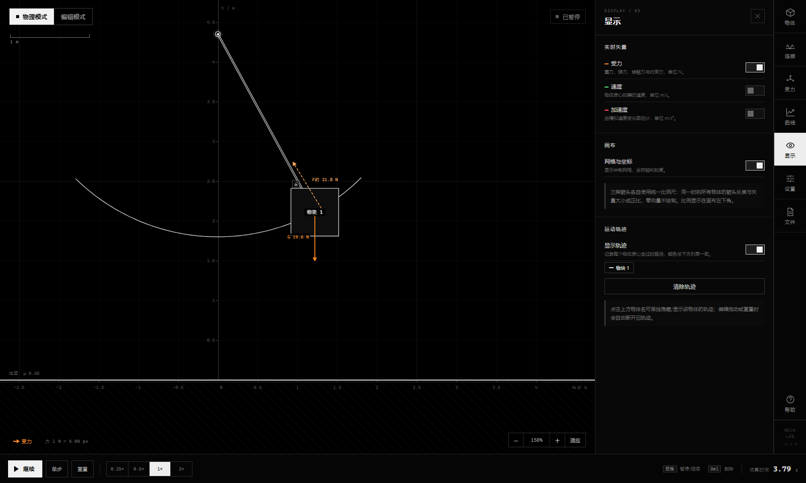

# 力学实验室 · Mechanics Lab

浏览器里运行的高中力学模拟器：真实单位与比例，拖拽即可对物体施力，实时显示受力 / 速度 / 加速度箭头，自动绘制 x–t、v–t、a–t、F–t 曲线，并可把任意时刻的完整场景存成 JSON 再恢复。

纯黑极简界面，单页应用，零依赖构建：**用浏览器打开 `index.html` 即可**。



- 当前版本：**v1.0.1**
- 技术栈：原生 HTML / CSS / JavaScript + Canvas 2D，物理引擎 [Matter.js](https://github.com/liabru/matter-js) 0.20.0（CDN 加载，自动回退 unpkg、cdnjs）
- 场景文件：`mechanics-lab.scene`，schema 1（见[格式规范](#场景文件格式-schema-1)）

## 功能

**场景物体**
- 物块（矩形刚体）、斜面（直角三角形，可左右朝向）
- 锚点（固定连接点）、动点（附着在物体或连接件上）、滑点（沿轻绳 / 硬杆滑动）

**连接件**
- 轻弹簧（可拉可压）、轻弹性绳（只拉不压）、轻硬杆（定长，可拉可压）、轻绳（不可伸长，只拉不推）
- 弹簧与硬杆的两个端点可**分别**锁定朝向，也可两端同时锁定

**两种模式**
- 物理模式：按住物体拖动 = 在物体上施加外力，松手立即撤销，模拟持续运行
- 编辑模式：模拟暂停，拖动改变位置，右侧面板修改质量、尺寸、摩擦、连接参数

**施力点**（设置 → 交互，默认「重心」）
- 重心：拖动只产生平动，不会让物体凭空旋转
- 指针：力作用在鼠标按下的位置，物体会被拉得转动起来
- 直接拖动动点 / 滑点时外力始终作用在点本身

**显示与分析**
- 矢量：受力（橙）、速度（绿）、加速度（红），同类箭头共用统一比例尺，零向量不绘制
- 运动轨迹：每个物体质心的路径，可按物体单独显示 / 隐藏；新旧交替处按时间连续淡出（逐像素渐变，无分级条带），永不硬截断
- 曲线面板：x–t（蓝）、v–t（绿）、a–t（红）、F–t（橙），每种分水平 x 与竖直 y 分量，60 Hz 采样，窗口 10 秒
- 受力面板：质点模型自由体图 + 逐力列表（大小、方向角、水平 / 竖直分量）+ 合力
- 锁定：点击物体左上角锁图标即可锁定 / 解锁，锁定物体完全静止但仍参与碰撞与受力分析
- 演示预设：综合演示、斜面滑块、弹簧振子、硬杆摆

**文件**
- 演示预设、导入、导出在「文件」面板中各占一栏
- 导出当前时刻的完整状态；导入支持文件选择或直接把 JSON 拖到画布上；出错时保留原场景并说明原因
- 兼容旧版本（v0.x）导出的场景文件，导入时自动迁移到 schema 1

## 界面

右侧工具栏（自上而下）：**物体 · 连接 · 受力 · 曲线 · 显示 · 设置 · 文件 · 帮助**，底部显示版本号。

底部控制栏：
- 左：开始 / 暂停、单步、重置，随后是倍速 0.25× / 0.5× / 1× / 2×
- 右：快捷键提示与**仿真时间**

## 操作速查

| 操作 | 方式 |
| --- | --- |
| 平移画布 | 在空白处按住拖动 |
| 缩放 | 滚轮（以指针为中心），或画布右下角 − / ＋ / 适应 |
| 开始 / 暂停 | 底部按钮或 `空格` |
| 单步 | 暂停时点「单步」（前进 1/60 秒） |
| 重置到初始位置 | `R` 或「重置」 |
| 删除选中物体 / 连接件 | `Del` |
| 取消当前操作 | `Esc` |
| 施加外力 | 物理模式下按住未锁定的物体、动点或滑点拖动 |
| 切换施力点 | 设置 → 交互 → 重心 / 指针 |
| 锁定物体 | 点物体左上角的锁图标 |
| 修改参数 | 编辑模式 → 右侧面板 |
| 导出场景 | 文件 →「导出当前场景」 |
| 导入场景 | 文件 →「选择场景文件…」，或把 JSON 拖到画布 |

## 物理模型

- 比例：1 m = 100 px（缩放 100%），读数一律使用国际单位
- 求解：360 Hz 固定步长；重力加速度 0–20 m/s²（默认 9.8）；无空气阻力
- 取值范围：质量 0.001–100 kg，摩擦系数 0–5，边长 / 底边 / 高 0.1–5 m，弹簧劲度 1–100 N/m
- 摩擦：库仑模型，接触面摩擦系数取两物体 μ 的较小值，最大静摩擦与滑动摩擦按同一 μ 计算
- 约束：轻绳 / 弹性绳只承受拉力（松弛时无约束力），硬杆保持定长；无法由接触力直接得到的约束力以 `F约` 显示残差
- 接触力画在真实接触点上，叠放物块之间的压力因此会单独显示
- 场景对象上限 200 个（防止误操作拖慢页面）

## 场景文件格式（schema 1）

导出文件是普通 UTF-8 JSON。**所有数值都是国际单位、y 轴向上**，与界面读数一致：

| 量 | 单位 / 约定 |
| --- | --- |
| 位置、长度、距离 | m，`+y` 向上，地面 y = 0 |
| 旋转 | rad，逆时针为正 |
| 速度、加速度 | m/s、m/s² |
| 角速度 | rad/s，逆时针为正 |
| 时间 | s |

```json
{
  "format": "mechanics-lab.scene",
  "schema": 1,
  "app": { "name": "Mechanics Lab", "version": "1.0.0" },
  "savedAt": "2026-11-17T12:00:00.000Z",
  "world": { "gravity": 9.8, "groundFriction": 0.5 },
  "simulation": { "time": 1.11, "running": false, "speed": 1, "mode": "physics", "dragAtPoint": false },
  "view": {
    "camera": { "x": 1.25, "y": 2.75, "zoom": 1.35 },
    "show": { "forces": true, "velocity": false, "acceleration": false, "grid": true, "trails": true },
    "selectedId": "b7",
    "panel": "analysis"
  },
  "naming": { "counters": { "block": 2, "anchor": 1 }, "nextId": 22, "trailColor": 3 },
  "entities": [
    {
      "type": "block", "id": "b7", "name": "物块 1",
      "mass": 2, "friction": 0.3, "size": { "w": 0.55, "h": 0.55 },
      "locked": false, "trail": { "visible": true, "color": "#72b7ff" },
      "state": {
        "position": { "x": 2.1, "y": 3.7 }, "rotation": 0.25,
        "velocity": { "x": 0.036, "y": 0.019 }, "spin": 0
      },
      "home": { "position": { "x": 2.1, "y": 3.7 }, "rotation": 0.25 }
    },
    {
      "type": "incline", "id": "i6", "name": "斜面 1",
      "mass": 10, "friction": 0.4, "size": { "base": 3, "h": 1.5 },
      "orientation": "right", "locked": true,
      "state": { "position": { "x": 0, "y": 0.75 }, "rotation": 0, "velocity": { "x": 0, "y": 0 }, "spin": 0 },
      "home": null
    },
    { "type": "anchor", "id": "a8", "name": "锚点 1", "position": { "x": 1.2, "y": 4.8 } },
    { "type": "point", "id": "p17", "name": "滑点 1", "pointType": "slider",
      "host": { "kind": "connector", "id": "c16" }, "param": 0.62, "split": false,
      "position": { "x": -4.33, "y": 3.43 } }
  ],
  "connectors": [
    {
      "type": "spring", "id": "c13", "name": "轻弹簧 1", "ends": ["a8", "b12"],
      "parameters": { "k": 26, "restLength": 1 },
      "fixed": { "a": true, "b": false, "direction": { "x": 0, "y": -1 }, "sign": 1 },
      "sliders": []
    },
    {
      "type": "rod", "id": "c10", "name": "轻硬杆 1", "ends": ["a8", "b9"],
      "length": 1.4,
      "fixed": { "a": true, "b": false, "direction": null, "sign": 1 },
      "sliders": []
    }
  ],
  "history": {
    "hz": 60, "window": 10,
    "series": [
      { "id": "b7", "t": [0, 0.0167], "x": [2.1, 2.1], "y": [3.7, 3.7],
        "vx": [0, 0.036], "vy": [0, 0.019], "ax": [0, 2.1], "ay": [0, 1.1],
        "fx": [0, 4.2], "fy": [0, 2.2] }
    ]
  },
  "trails": [
    { "id": "b7", "color": "#72b7ff", "segments": [[2.1, 3.7, 0, 2.11, 3.74, 0.0167]] }
  ]
}
```

字段说明：

- `entities[].type`：`block`、`incline`、`anchor`、`point`；点用 `pointType`（`dynamic` / `slider`）与 `host`（`entity` / `connector`）描述依附关系；`split: true` 表示它是由拆分连接件产生的中继结点（自带代理体）
- `connectors[].type`：`spring`、`elastic`、`rod`、`rope`；`ends` 是两个端点的实体 id；`parameters` 只用于弹簧 / 弹性绳，`length` 只用于硬杆 / 轻绳；`fixed.direction` 是锁定的轴向（y 向上）
- `history.series[*]` 的通道为 `t, x, y, vx, vy, ax, ay, fx, fy`；`trails[*].segments` 是扁平的 `[x, y, t, ...]` 三元组
- `history` / `trails` 只在勾选「包含曲线与轨迹」时写入；缺失时导入后曲线从零开始
- 未知字段被忽略；`format` 不符、`schema` 高于 1、物体类型未知或 id 重复时整份文件被拒绝，当前场景保持不变
- 旧版（`format: "mechanics-lab-scene"`）文件会被自动迁移

## 项目结构

```
index.html   页面骨架：画布、模式切换、面板容器、底部控制栏
styles.css   纯黑极简样式、面板排版、响应式断点
app.js       全部逻辑（单文件 IIFE，按 §0–§3 分区）：
             · 常量与工具
             · 场景文件格式（序列化 / 校验 / 旧版迁移）
             · 物理与交互
             · 面板与图表
             · 渲染与启动
LICENSE      GPL-3.0
```

## 兼容性与限制

- 需要支持 Pointer Events、Canvas 2D、`ResizeObserver` 的现代浏览器（Chrome / Edge / Firefox / Safari 近年版本）；移动端可浏览但未做触控优化
- 物理引擎从 CDN 加载，首次打开需要联网；全部 CDN 失败时页面显示明确提示
- 标签页切到后台时自动暂停并停止动画循环，切回后续跑，避免空转耗电
- Matter.js 是刚体引擎，摩擦与绳索约束是在其之上自行实现的近似模型；极小质量或极大劲度系数下可能出现轻微数值振荡

## 版本记录

**v1.0.1**
- 轨迹渐隐改为逐像素连续渐变：尾段用少量长切片 + 线性渐变描边，透明度随点连续变化，不再出现分级条带或接缝亮点；轨迹出现 / 隐藏 / 清除仍然交叉淡出

**v1.0.0**
- 侧边栏重整为「物体 · 连接 · 受力 · 曲线 · 显示 · 设置 · 文件 · 帮助」八栏，预设 / 导入 / 导出各自独立成栏，施力点切换移入设置
- 底部栏：倍速靠左与播放控件对齐，仿真时间移到右侧，去掉冗余文字标签
- 运动轨迹改为分段 + 时间淡出，缓冲裁剪不再出现硬截断
- 场景文件定为 schema 1（SI、y 轴向上、显式实体与连接件结构），并兼容旧文件
- 性能：按帧缓存物体列表与绳索路径、面板节点复用、图表与受力面板节流，18 物体 + 16 连接件场景稳定 60 fps
- 修复：编辑模式拖动拉长轻绳、窄窗口下仿真时间被隐藏、导入时 NaN/Infinity 未拦截、对象数量无上限
- 增加全局错误提示、页面隐藏暂停、卸载时释放动画循环与观察器

## 许可

本项目以 GNU General Public License v3.0 发布，详见 [LICENSE](LICENSE)。
